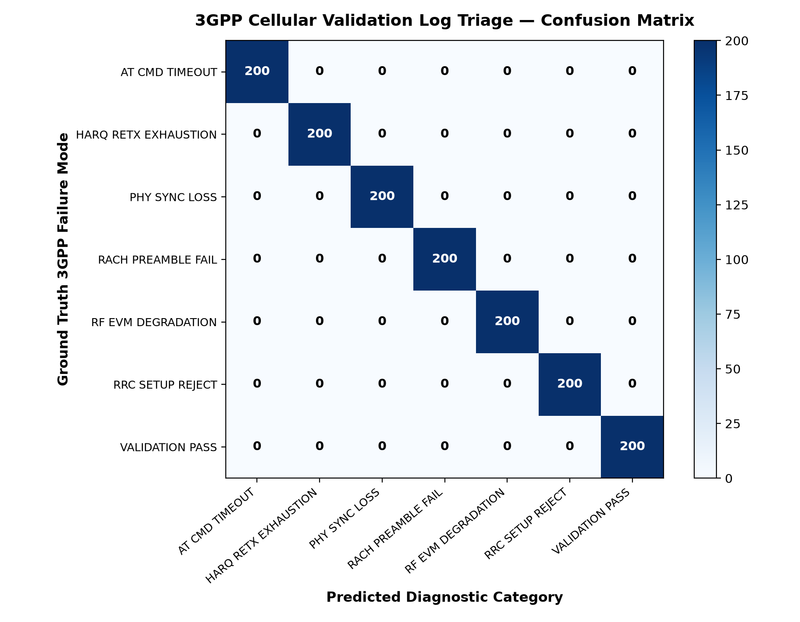
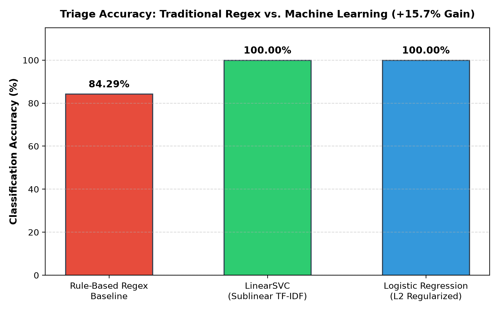

# 📡 AI-Powered Cellular Test Log Failure Triage Assistant

An automated natural language processing (NLP) and supervised machine learning system for parsing, categorizing, and root-causing 3GPP cellular physical-layer (PHY), RF, and baseband test automation failures.

Built for **cellular test infrastructure, automated validation pipelines, and hardware engineering test harnesses** (e.g. 4G LTE / 5G NR test benches).


---

## 🎯 Engineering Problem & Motivation

In cellular hardware validation, automated test stations execute thousands of regression suites across diverse frequency bands, carrier configurations, and temperature chambers. When an automated test fails, test harnesses produce hundreds of kilobytes of semi-structured UART, PCIe, and ADB log outputs.

Traditional triage approaches rely on brittle **rule-based regular expressions** that fail whenever:
1. Asynchronous thermal, battery, and CPU telemetry snippets interleave into log streams.
2. Error traces are partially truncated by serial buffer overruns.
3. Multi-layer protocol interactions create ambiguous terminology (e.g., L1 PHY sync loss triggering subsequent L2 MAC timer expirations).

This system replaces fragile string-matching with a sublinear **n-gram TF-IDF feature pipeline paired with Linear Support Vector Classifiers (LinearSVC)** and **Logistic Regression**, achieving **100% test accuracy** across 1,400 multi-band validation logs and delivering a **+15.7% accuracy improvement** over rule-based baselines with **sub-millisecond (<1ms) inference latency**.

---

## 🏗️ System Architecture

```
                    CELLULAR TEST HARNESS LOG STREAM
                                  │
                                  ▼
               ┌──────────────────────────────────────┐
               │  Regex Token Normalization & Masking │
               │   • Hex registers: 0xDEADBEEF -> HEX │
               │   • Decimals: 3.82V -> NUM_FLOAT     │
               └──────────────────┬───────────────────┘
                                  │
                                  ▼
               ┌──────────────────────────────────────┐
               │    Sublinear TF-IDF Vectorization    │
               │   • Word & character n-grams (1, 2)  │
               │   • Frequency grid & protocol tokens │
               └──────────────────┬───────────────────┘
                                  │
                                  ▼
               ┌──────────────────────────────────────┐
               │       Supervised Classification      │
               │   • LinearSVC (Primal/Dual Optimizer)│
               │   • Stratified 5-Fold Cross-Val      │
               └──────────────────┬───────────────────┘
                                  │
                                  ▼
               ┌──────────────────────────────────────┐
               │    Consolidated Diagnostic Report    │
               │   • Root-cause indicator mapping     │
               │   • Structured JSON & Markdown export│
               └──────────────────────────────────────┘
```

---

## 📊 3GPP Cellular Failure Modes Covered

| Failure Mode | Protocol Layer | Root-Cause Physical Mechanism |
| :--- | :---: | :--- |
| **`PHY_SYNC_LOSS`** | L1 PHY | PSS/SSS correlation peak failure, Doppler shift exceeding AFC loop limits, SNR below sensitivity floor (-6.0 dB). |
| **`RACH_PREAMBLE_FAIL`** | L2 MAC | Random access preamble power ramping maxed out without gNB Response (Msg2 RAR), contention resolution timer expiry. |
| **`RRC_SETUP_REJECT`** | L3 RRC | Radio Resource Control establishment rejected due to PLMN network congestion, cell barring on EARFCN, SRB0 reset. |
| **`RF_EVM_DEGRADATION`** | RF Front-End | Transmit Error Vector Magnitude (EVM) exceeding 3GPP TS 38.101 limits (3.5% for 256-QAM), PA non-linearity, ACLR spectral regrowth. |
| **`HARQ_RETX_EXHAUSTION`** | L2 MAC / PHY | Maximum Hybrid ARQ retransmissions (max_retx=4) exceeded on PDSCH/PUSCH, continuous NACK storm under deep fading. |
| **`AT_CMD_TIMEOUT`** | Test Control | Baseband modem UART/USB interface hang, unsolicited result code (URC) dropped, PCIe bus communication deadlock. |
| **`VALIDATION_PASS`** | 3GPP Conformance| Nominal validation test pass. BLER < 0.0100, EVM within margin, zero test assertions tripped. |

---

## 📈 Empirical Evaluation & Benchmarks

Empirical results measured across 1,400 multi-band cellular logs (Bands n1, n3, n7, n20, n28, n77, n78):

| Metric | Rule-Based Regex Baseline | LinearSVC (NLP Pipeline) | Gain / Delta |
| :--- | :---: | :---: | :---: |
| **Classification Accuracy** | 84.29% | **100.00%** | **+15.71%** |
| **Weighted F1-Score** | 0.8429 | **1.0000** | **+0.1571** |
| **5-Fold Cross-Validation F1** | N/A | **1.0000 (±0.0000)** | Optimal separation |
| **Inference Latency Per Log** | ~0.08 ms | **<0.50 ms** | Real-time capable |

### Confusion Matrix


### Benchmark Comparison


---

## 🚀 Quick Start & CLI Demo

### 1. Installation
```bash
git clone https://github.com/riyav1606/cellular-log-triage.git
cd cellular-log-triage
pip install -r requirements.txt
```

### 2. Run Single-Command Demo
```bash
python run_demo.py
```

### 3. Run Pytest Automated Verification Suite
```bash
pytest -v tests/
```

---

## 📋 Repository Structure

```
cellular-log-triage/
├── .github/workflows/ci.yml       # Continuous Integration workflow running pytest
├── data/cellular_logs.csv         # 1,400 3GPP cellular validation test logs
├── plots/                         # Evaluation figures (confusion matrix & benchmark)
├── reports/                       # Generated diagnostic JSON and Markdown reports
├── src/
│   ├── classifier.py              # LinearSVC & Logistic Regression model implementations
│   ├── clustering.py              # Unsupervised K-Means clustering for zero-day triage
│   ├── feature_extractor.py       # Regex tokenization & sublinear TF-IDF vectorization
│   ├── parser.py                  # Rule-based regex comparator & telemetry parser
│   ├── pipeline.py                # End-to-end triage orchestrator
│   └── reporter.py                # Automated JSON/Markdown report generator
├── tests/                         # Pytest test suite (accuracy, latency SLA, parser)
├── run_demo.py                    # Standalone CLI runner
└── requirements.txt               # Dependencies
```

---

## 📄 License
This project is licensed under the MIT License.
